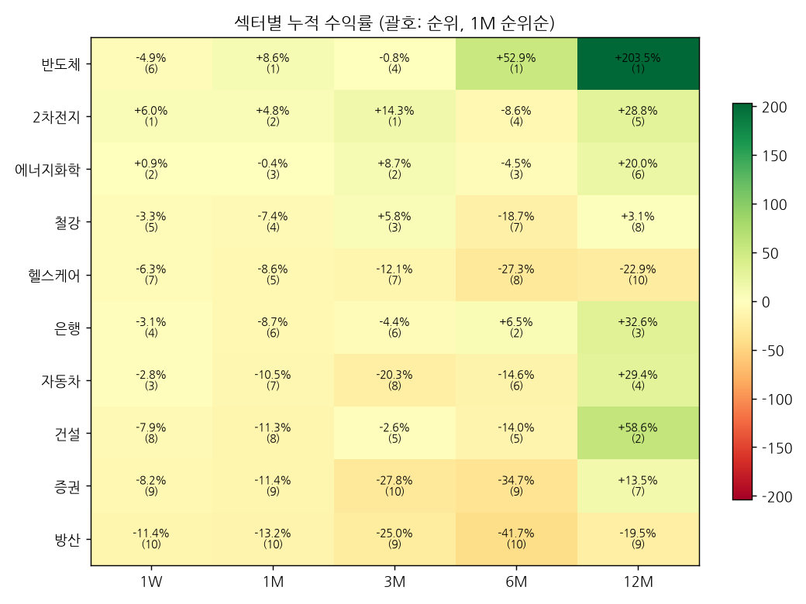

# 섹터 로테이션 & 관심종목 리포트 — 2026-10-12 (weekly)

## 1. 시그널
- 🔴 **[주도 약화] 건설** — 12M 2위·6M 5위 → 1M 8위·1W 8위
- 🔴 **[1M 순위 급변] 건설** — 3위 → 8위 (▼5)
- 🔴 **[주도 약화] 반도체** — 12M 1위·6M 1위 → 1M 1위·1W 6위
- 🔴 **[1W 순위 급변] 반도체** — 2위 → 6위 (▼4)
- 🔴 **[1W 순위 급변] 방산** — 4위 → 10위 (▼6)
- 🔴 **[1M 순위 급변] 방산** — 4위 → 10위 (▼6)
- 🔴 **[주도 약화] 은행** — 12M 3위·6M 2위 → 1M 6위·1W 4위
- 🔴 **[3M 순위 급변] 은행** — 2위 → 6위 (▼4)
- 🟢 **[1M 순위 급변] 2차전지** — 5위 → 2위 (▲3)
- 🟢 **[3M 순위 급변] 2차전지** — 4위 → 1위 (▲3)
- 🟢 **[3M 순위 급변] 반도체** — 7위 → 4위 (▲3)
- 🟢 **[1W 순위 급변] 은행** — 9위 → 4위 (▲5)
- 🟢 **[1M 순위 급변] 자동차** — 10위 → 7위 (▲3)
- 🟢 **[1M 순위 급변] 헬스케어** — 9위 → 5위 (▲4)

_순위변동 기준: 2026-10-05 리포트 대비_

## 2. 섹터 누적수익률 맵 (1M 순위순)
| 섹터 | 1W | 1M | 3M | 6M | 12M |
|---|---|---|---|---|---|
| **반도체** | -4.9% (6위 ▼4) | +8.6% (1위) | -0.8% (4위 ▲3) | +52.9% (1위) | +203.5% (1위) |
| **2차전지** | +6.0% (1위 ▲2) | +4.8% (2위 ▲3) | +14.3% (1위 ▲3) | -8.6% (4위 ▲1) | +28.8% (5위) |
| **에너지화학** | +0.9% (2위 ▼1) | -0.4% (3위 ▼1) | +8.7% (2위 ▼1) | -4.5% (3위) | +20.0% (6위) |
| **철강** | -3.3% (5위 ▲2) | -7.4% (4위 ▲2) | +5.8% (3위) | -18.7% (7위 ▼1) | +3.1% (8위) |
| **헬스케어** | -6.3% (7위 ▼2) | -8.6% (5위 ▲4) | -12.1% (7위 ▼1) | -27.3% (8위 ▲2) | -22.9% (10위) |
| **은행** | -3.1% (4위 ▲5) | -8.7% (6위 ▲2) | -4.4% (6위 ▼4) | +6.5% (2위) | +32.6% (3위) |
| **자동차** | -2.8% (3위 ▲3) | -10.5% (7위 ▲3) | -20.3% (8위 ▲1) | -14.6% (6위 ▲1) | +29.4% (4위) |
| **건설** | -7.9% (8위 ▲2) | -11.3% (8위 ▼5) | -2.6% (5위) | -14.0% (5위 ▼1) | +58.6% (2위) |
| **증권** | -8.2% (9위 ▼1) | -11.4% (9위 ▼2) | -27.8% (10위) | -34.7% (9위) | +13.5% (7위) |
| **방산** | -11.4% (10위 ▼6) | -13.2% (10위 ▼6) | -25.0% (9위 ▼1) | -41.7% (10위 ▼2) | -19.5% (9위) |

## 3. 관심종목 자동 업데이트
변동 없음

## 4. 기술적 지표 점검
### 삼성전자 (005930) — 현재가 256,500
- **이평선**: 혼조 · MA5 267,500▼ / MA20 266,600▼ / MA60 257,617▼ / MA120 273,288▼
- **크로스(최근)**: MA5 하향이탈, MA20 하향이탈, MA60 하향이탈, MA120 하향이탈
- **거래량**: 보합 · 5/20일 0.83x · 20/60일 0.7x · 당일/20일 0.25x
- **120일 매물벽**: 262,548 (+2.4%, 비중 10.7%) · 상단 총매물 68.2% → 매물대 하단(무거움) · 최대매물대 270,269 (+5.4%)
- **Cup&Handle**: 패턴 미성립 (점수 28) · 깊이 49.5% · 컵 28일 · 핸들 35일/되돌림 15.6% · 피벗 288,000 (+12.3%)
  - 미충족: 컵 길이 ≥30일, 우측 회복 ≥85%, 핸들 5~25일, 핸들 되돌림 ≤15%, 핸들 컵 상단 절반

### SK하이닉스 (000660) — 현재가 1,621,000
- **이평선**: 혼조 · MA5 1,729,600▼ / MA20 1,784,050▼ / MA60 1,706,600▼ / MA120 1,844,842▼
- **크로스(최근)**: 데드 5/20 (2026-10-07), MA5 하향이탈, MA20 하향이탈, MA60 하향이탈, MA120 하향이탈
- **거래량**: 보합 · 5/20일 0.77x · 20/60일 0.68x · 당일/20일 0.27x
- **120일 매물벽**: 1,674,562 (+3.3%, 비중 10.0%) · 상단 총매물 75.1% → 매물대 하단(무거움) · 최대매물대 1,754,104 (+8.2%)
- **Cup&Handle**: 패턴 미성립 (점수 28) · 깊이 58.3% · 컵 24일 · 핸들 10일/되돌림 16.5% · 피벗 1,935,000 (+19.4%)
  - 미충족: 깊이 12~50%, 컵 길이 ≥30일, 우측 회복 ≥85%, 핸들 되돌림 ≤15%, 핸들 컵 상단 절반

### 현대차 (005380) — 현재가 325,500
- **이평선**: 역배열 · MA5 336,400▼ / MA20 357,650▼ / MA60 388,592▼ / MA120 485,975▼
- **크로스(최근)**: MA5 하향이탈
- **거래량**: 보합 · 5/20일 1.01x · 20/60일 0.73x · 당일/20일 0.51x
- **120일 매물벽**: 387,521 (+19.1%, 비중 6.4%) · 상단 총매물 100.0% → 매물대 하단(무거움) · 최대매물대 638,312 (+96.1%)
- **Cup&Handle**: 패턴 미성립 (점수 14) · 깊이 59.1% · 컵 89일 · 핸들 0일/되돌림 0% · 피벗 334,000 (+2.6%)
  - 미충족: 깊이 12~50%, 우측 회복 ≥85%, 핸들 5~25일, 핸들 되돌림 ≤15%, 핸들 컵 상단 절반, 핸들 거래량 감소

---
_자동 생성. 투자 판단의 참고 자료이며 매매 권유가 아닙니다._