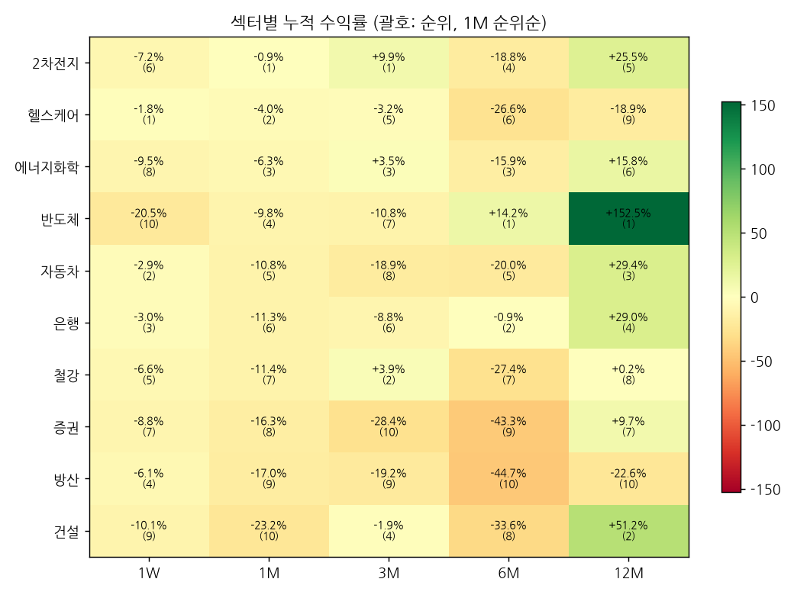

# 섹터 로테이션 & 관심종목 리포트 — 2026-10-18 (weekly)

## 1. 시그널
- 🔴 **[1W 순위 급변] 2차전지** — 1위 → 6위 (▼5)
- 🔴 **[주도 약화] 건설** — 12M 2위·6M 8위 → 1M 10위·1W 9위
- 🔴 **[주도 약화] 반도체** — 12M 1위·6M 1위 → 1M 4위·1W 10위
- 🔴 **[1W 순위 급변] 반도체** — 6위 → 10위 (▼4)
- 🔴 **[1M 순위 급변] 반도체** — 1위 → 4위 (▼3)
- 🔴 **[3M 순위 급변] 반도체** — 4위 → 7위 (▼3)
- 🔴 **[주도 약화] 에너지화학** — 12M 6위·6M 3위 → 1M 3위·1W 8위
- 🔴 **[1W 순위 급변] 에너지화학** — 2위 → 8위 (▼6)
- 🔴 **[주도 약화] 은행** — 12M 4위·6M 2위 → 1M 6위·1W 3위
- 🔴 **[1M 순위 급변] 철강** — 4위 → 7위 (▼3)
- 🟢 **[1W 순위 급변] 방산** — 10위 → 4위 (▲6)
- 🟢 **[신규 주도 후보] 헬스케어** — 12M 9위·6M 6위 → 1M 2위·1W 1위
- 🟢 **[1W 순위 급변] 헬스케어** — 7위 → 1위 (▲6)
- 🟢 **[1M 순위 급변] 헬스케어** — 5위 → 2위 (▲3)

_순위변동 기준: 2026-10-12 리포트 대비_

## 2. 섹터 누적수익률 맵 (1M 순위순)
| 섹터 | 1W | 1M | 3M | 6M | 12M |
|---|---|---|---|---|---|
| **2차전지** | -7.2% (6위 ▼5) | -0.9% (1위 ▲1) | +9.9% (1위) | -18.8% (4위) | +25.5% (5위) |
| **헬스케어** | -1.8% (1위 ▲6) | -4.0% (2위 ▲3) | -3.2% (5위 ▲2) | -26.6% (6위 ▲2) | -18.9% (9위 ▲1) |
| **에너지화학** | -9.5% (8위 ▼6) | -6.3% (3위) | +3.5% (3위 ▼1) | -15.9% (3위) | +15.8% (6위) |
| **반도체** | -20.5% (10위 ▼4) | -9.8% (4위 ▼3) | -10.8% (7위 ▼3) | +14.2% (1위) | +152.5% (1위) |
| **자동차** | -2.9% (2위 ▲1) | -10.8% (5위 ▲2) | -18.9% (8위) | -20.0% (5위 ▲1) | +29.4% (3위 ▲1) |
| **은행** | -3.0% (3위 ▲1) | -11.3% (6위) | -8.8% (6위) | -0.9% (2위) | +29.0% (4위 ▼1) |
| **철강** | -6.6% (5위) | -11.4% (7위 ▼3) | +3.9% (2위 ▲1) | -27.4% (7위) | +0.2% (8위) |
| **증권** | -8.8% (7위 ▲2) | -16.3% (8위 ▲1) | -28.4% (10위) | -43.3% (9위) | +9.7% (7위) |
| **방산** | -6.1% (4위 ▲6) | -17.0% (9위 ▲1) | -19.2% (9위) | -44.7% (10위) | -22.6% (10위 ▼1) |
| **건설** | -10.1% (9위 ▼1) | -23.2% (10위 ▼2) | -1.9% (4위 ▲1) | -33.6% (8위 ▼3) | +51.2% (2위) |

## 3. 관심종목 자동 업데이트
변동 없음

## 4. 기술적 지표 점검
### 삼성전자 (005930) — 현재가 217,000
- **이평선**: 혼조 · MA5 228,800▼ / MA20 258,650▼ / MA60 254,875▼ / MA120 273,592▼
- **크로스(최근)**: 데드 5/20 (2026-10-13), MA60 하향이탈
- **거래량**: 보합 · 5/20일 1.31x · 20/60일 0.8x · 당일/20일 1.04x
- **120일 매물벽**: 247,106 (+13.9%, 비중 5.6%) · 상단 총매물 93.5% → 매물대 하단(무거움) · 최대매물대 270,269 (+24.5%)
- **Cup&Handle**: 패턴 미성립 (점수 28) · 깊이 49.5% · 컵 28일 · 핸들 39일/되돌림 29.0% · 피벗 288,000 (+32.7%)
  - 미충족: 컵 길이 ≥30일, 우측 회복 ≥85%, 핸들 5~25일, 핸들 되돌림 ≤15%, 핸들 컵 상단 절반

### SK하이닉스 (000660) — 현재가 1,265,000
- **이평선**: 혼조 · MA5 1,397,800▼ / MA20 1,692,250▼ / MA60 1,668,033▼ / MA120 1,851,892▼
- **크로스(최근)**: 없음
- **거래량**: 보합 · 5/20일 1.35x · 20/60일 0.79x · 당일/20일 1.36x
- **120일 매물벽**: 1,564,042 (+23.6%, 비중 6.9%) · 상단 총매물 94.4% → 매물대 하단(무거움) · 최대매물대 1,794,792 (+41.9%)
- **Cup&Handle**: 패턴 미성립 (점수 42) · 깊이 58.6% · 컵 75일 · 핸들 1일/되돌림 6.4% · 피벗 1,332,000 (+5.3%)
  - 미충족: 깊이 12~50%, 우측 회복 ≥85%, 핸들 5~25일, 핸들 컵 상단 절반

### 현대차 (005380) — 현재가 314,000
- **이평선**: 혼조 · MA5 309,400▲ / MA20 342,375▼ / MA60 380,158▼ / MA120 478,892▼
- **크로스(최근)**: MA5 상향돌파
- **거래량**: 보합 · 5/20일 1.36x · 20/60일 0.85x · 당일/20일 1.53x
- **120일 매물벽**: 381,625 (+21.5%, 비중 5.6%) · 상단 총매물 98.6% → 매물대 하단(무거움) · 최대매물대 402,208 (+28.1%)
- **Cup&Handle**: 패턴 미성립 (점수 14) · 깊이 63.1% · 컵 92일 · 핸들 0일/되돌림 0% · 피벗 320,500 (+2.1%)
  - 미충족: 깊이 12~50%, 우측 회복 ≥85%, 핸들 5~25일, 핸들 되돌림 ≤15%, 핸들 컵 상단 절반, 핸들 거래량 감소

---
_자동 생성. 투자 판단의 참고 자료이며 매매 권유가 아닙니다._