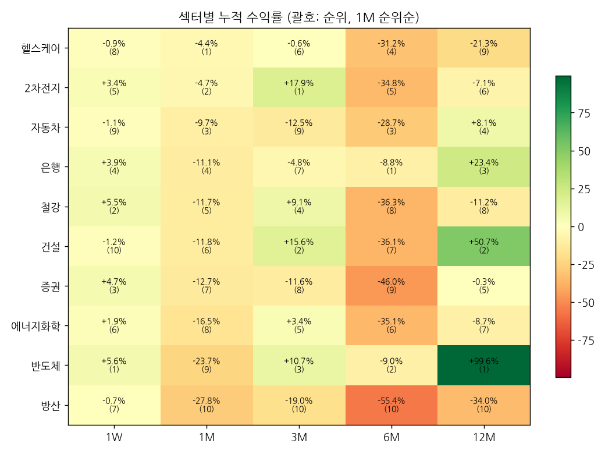

# 섹터 로테이션 & 관심종목 리포트 — 2026-11-02 (monthly)

## 1. 시그널
- 🔴 **[주도 약화] 건설** — 12M 2위·6M 7위 → 1M 6위·1W 10위
- 🔴 **[1W 순위 급변] 건설** — 1위 → 10위 (▼9)
- 🔴 **[주도 약화] 반도체** — 12M 1위·6M 2위 → 1M 9위·1W 1위
- 🔴 **[1M 순위 급변] 에너지화학** — 4위 → 8위 (▼4)
- 🔴 **[주도 약화] 자동차** — 12M 4위·6M 3위 → 1M 3위·1W 9위
- 🔴 **[1W 순위 급변] 자동차** — 4위 → 9위 (▼5)
- 🔴 **[1W 순위 급변] 헬스케어** — 2위 → 8위 (▼6)
- 🟢 **[1W 순위 급변] 반도체** — 7위 → 1위 (▲6)
- 🟢 **[3M 순위 급변] 반도체** — 7위 → 3위 (▲4)
- 🟢 **[신규 주도 후보] 증권** — 12M 5위·6M 9위 → 1M 7위·1W 3위
- 🟢 **[신규 주도 후보] 철강** — 12M 8위·6M 8위 → 1M 5위·1W 2위
- 🟢 **[1W 순위 급변] 철강** — 6위 → 2위 (▲4)
- 🟢 **[1M 순위 급변] 철강** — 9위 → 5위 (▲4)
- 🟢 **[신규 주도 후보] 헬스케어** — 12M 9위·6M 4위 → 1M 1위·1W 8위

_순위변동 기준: 2026-10-25 리포트 대비_

## 2. 섹터 누적수익률 맵 (1M 순위순)
| 섹터 | 1W | 1M | 3M | 6M | 12M |
|---|---|---|---|---|---|
| **헬스케어** | -0.9% (8위 ▼6) | -4.4% (1위) | -0.6% (6위 ▼2) | -31.2% (4위 ▲2) | -21.3% (9위) |
| **2차전지** | +3.4% (5위 ▲3) | -4.7% (2위) | +17.9% (1위 ▲1) | -34.8% (5위 ▼2) | -7.1% (6위 ▼1) |
| **자동차** | -1.1% (9위 ▼5) | -9.7% (3위) | -12.5% (9위 ▼1) | -28.7% (3위 ▲1) | +8.1% (4위) |
| **은행** | +3.9% (4위 ▲1) | -11.1% (4위 ▲1) | -4.8% (7위 ▼1) | -8.8% (1위 ▲1) | +23.4% (3위) |
| **철강** | +5.5% (2위 ▲4) | -11.7% (5위 ▲4) | +9.1% (4위 ▼1) | -36.3% (8위) | -11.2% (8위) |
| **건설** | -1.2% (10위 ▼9) | -11.8% (6위) | +15.6% (2위 ▼1) | -36.1% (7위) | +50.7% (2위) |
| **증권** | +4.7% (3위) | -12.7% (7위) | -11.6% (8위 ▲2) | -46.0% (9위) | -0.3% (5위 ▲1) |
| **에너지화학** | +1.9% (6위 ▲3) | -16.5% (8위 ▼4) | +3.4% (5위) | -35.1% (6위 ▼1) | -8.7% (7위) |
| **반도체** | +5.6% (1위 ▲6) | -23.7% (9위 ▼1) | +10.7% (3위 ▲4) | -9.0% (2위 ▼1) | +99.6% (1위) |
| **방산** | -0.7% (7위 ▲3) | -27.8% (10위) | -19.0% (10위 ▼1) | -55.4% (10위) | -34.0% (10위) |

## 3. 관심종목 자동 업데이트
변동 없음

## 4. 기술적 지표 점검
### 삼성전자 (005930) — 현재가 224,250
- **이평선**: 역배열 · MA5 229,050▼ / MA20 233,388▼ / MA60 251,012▼ / MA120 273,227▼
- **크로스(최근)**: MA5 하향이탈, MA20 하향이탈
- **거래량**: 보합 · 5/20일 0.92x · 20/60일 0.92x · 당일/20일 0.25x
- **120일 매물벽**: 247,106 (+10.2%, 비중 6.2%) · 상단 총매물 90.2% → 매물대 하단(무거움) · 최대매물대 270,269 (+20.5%)
- **Cup&Handle**: 패턴 미성립 (점수 28) · 깊이 49.5% · 컵 28일 · 핸들 50일/되돌림 29.3% · 피벗 288,000 (+28.4%)
  - 미충족: 컵 길이 ≥30일, 우측 회복 ≥85%, 핸들 5~25일, 핸들 되돌림 ≤15%, 핸들 컵 상단 절반

### SK하이닉스 (000660) — 현재가 1,454,000
- **이평선**: 혼조 · MA5 1,448,600▲ / MA20 1,441,400▲ / MA60 1,606,867▼ / MA120 1,856,333▼
- **크로스(최근)**: 골든 5/20 (2026-11-02), MA5 상향돌파, MA20 상향돌파
- **거래량**: 보합 · 5/20일 0.94x · 20/60일 0.97x · 당일/20일 0.24x
- **120일 매물벽**: 1,587,167 (+9.2%, 비중 7.1%) · 상단 총매물 87.5% → 매물대 하단(무거움) · 최대매물대 1,814,167 (+24.8%)
- **Cup&Handle**: 패턴 미성립 (점수 42) · 깊이 60.8% · 컵 81일 · 핸들 2일/되돌림 13.0% · 피벗 1,587,000 (+9.1%)
  - 미충족: 깊이 12~50%, 우측 회복 ≥85%, 핸들 5~25일, 핸들 컵 상단 절반

### 현대차 (005380) — 현재가 288,000
- **이평선**: 역배열 · MA5 289,400▼ / MA20 308,650▼ / MA60 362,958▼ / MA120 456,854▼
- **크로스(최근)**: MA5 하향이탈
- **거래량**: 보합 · 5/20일 0.98x · 20/60일 1.04x · 당일/20일 0.26x
- **120일 매물벽**: 387,948 (+34.7%, 비중 7.2%) · 상단 총매물 97.9% → 매물대 하단(무거움) · 최대매물대 644,198 (+123.7%)
- **Cup&Handle**: 패턴 미성립 (점수 14) · 깊이 65.5% · 컵 104일 · 핸들 0일/되돌림 0% · 피벗 288,500 (+0.2%)
  - 미충족: 깊이 12~50%, 우측 회복 ≥85%, 핸들 5~25일, 핸들 되돌림 ≤15%, 핸들 컵 상단 절반, 핸들 거래량 감소

### [섹터] 반도체 (-) — 현재가 108,860
- **이평선**: 역배열 · MA5 110,997▼ / MA20 121,705▼ / MA60 124,905▼ / MA120 137,441▼
- **크로스(최근)**: 데드 20/60 (2026-10-30), MA5 하향이탈
- **거래량**: 보합 · 5/20일 0.66x · 20/60일 1.19x · 당일/20일 0.32x
- **120일 매물벽**: 124,251 (+14.1%, 비중 5.4%) · 상단 총매물 95.2% → 매물대 하단(무거움) · 최대매물대 157,546 (+44.7%)
- **Cup&Handle**: 패턴 미성립 (점수 14) · 깊이 52.9% · 컵 28일 · 핸들 19일/되돌림 33.2% · 피벗 152,310 (+39.9%)
  - 미충족: 깊이 12~50%, 컵 길이 ≥30일, 우측 회복 ≥85%, 핸들 되돌림 ≤15%, 핸들 컵 상단 절반, 핸들 거래량 감소

### [섹터] 자동차 (-) — 현재가 22,460
- **이평선**: 역배열 · MA5 22,741▼ / MA20 23,819▼ / MA60 26,338▼ / MA120 29,832▼
- **크로스(최근)**: MA5 하향이탈
- **거래량**: 보합 · 5/20일 0.9x · 20/60일 0.72x · 당일/20일 0.58x
- **120일 매물벽**: 29,577 (+31.7%, 비중 5.7%) · 상단 총매물 99.9% → 매물대 하단(무거움) · 최대매물대 38,311 (+70.6%)
- **Cup&Handle**: 패턴 미성립 (점수 28) · 깊이 49.6% · 컵 104일 · 핸들 0일/되돌림 0% · 피벗 22,505 (+0.2%)
  - 미충족: 우측 회복 ≥85%, 핸들 5~25일, 핸들 되돌림 ≤15%, 핸들 컵 상단 절반, 핸들 거래량 감소

### [섹터] 은행 (-) — 현재가 14,200
- **이평선**: 혼조 · MA5 14,108▲ / MA20 14,702▼ / MA60 15,675▼ / MA120 15,394▼
- **크로스(최근)**: MA5 상향돌파
- **거래량**: 보합 · 5/20일 0.86x · 20/60일 0.71x · 당일/20일 0.33x
- **120일 매물벽**: 14,713 (+3.6%, 비중 5.4%) · 상단 총매물 95.4% → 매물대 하단(무거움) · 최대매물대 15,641 (+10.1%)
- **Cup&Handle**: 패턴 미성립 (점수 42) · 깊이 24.9% · 컵 7일 · 핸들 31일/되돌림 21.4% · 피벗 17,111 (+20.5%)
  - 미충족: 컵 길이 ≥30일, 핸들 5~25일, 핸들 되돌림 ≤15%, 핸들 컵 상단 절반

### [섹터] 증권 (-) — 현재가 15,045
- **이평선**: 역배열 · MA5 15,180▼ / MA20 15,559▼ / MA60 17,360▼ / MA120 20,399▼
- **크로스(최근)**: MA5 하향이탈
- **거래량**: 보합 · 5/20일 0.62x · 20/60일 0.78x · 당일/20일 0.3x
- **120일 매물벽**: 18,401 (+22.3%, 비중 6.6%) · 상단 총매물 98.8% → 매물대 하단(무거움) · 최대매물대 24,628 (+63.7%)
- **Cup&Handle**: 패턴 미성립 (점수 42) · 깊이 58.3% · 컵 115일 · 핸들 2일/되돌림 7.6% · 피벗 15,800 (+5.0%)
  - 미충족: 깊이 12~50%, 우측 회복 ≥85%, 핸들 5~25일, 핸들 컵 상단 절반

### [섹터] 건설 (-) — 현재가 5,990
- **이평선**: 역배열 · MA5 6,044▼ / MA20 6,092▼ / MA60 6,605▼ / MA120 6,822▼
- **크로스(최근)**: MA5 하향이탈, MA20 하향이탈
- **거래량**: 감소(마름) · 5/20일 0.57x · 20/60일 0.98x · 당일/20일 0.35x
- **120일 매물벽**: 6,028 (+0.6%, 비중 6.1%) · 상단 총매물 87.5% → 매물대 하단(무거움) · 최대매물대 6,659 (+11.2%)
- **Cup&Handle**: 패턴 미성립 (점수 14) · 깊이 51.5% · 컵 63일 · 핸들 32일/되돌림 26.5% · 피벗 7,585 (+26.6%)
  - 미충족: 깊이 12~50%, 우측 회복 ≥85%, 핸들 5~25일, 핸들 되돌림 ≤15%, 핸들 컵 상단 절반, 핸들 거래량 감소

### [섹터] 철강 (-) — 현재가 10,600
- **이평선**: 혼조 · MA5 10,355▲ / MA20 11,114▼ / MA60 11,955▼ / MA120 12,488▼
- **크로스(최근)**: MA5 상향돌파
- **거래량**: 감소(마름) · 5/20일 0.45x · 20/60일 0.4x · 당일/20일 0.53x
- **120일 매물벽**: 11,687 (+10.3%, 비중 7.5%) · 상단 총매물 93.9% → 매물대 하단(무거움) · 최대매물대 12,043 (+13.6%)
- **Cup&Handle**: 패턴 미성립 (점수 42) · 깊이 48.1% · 컵 103일 · 핸들 43일/되돌림 25.6% · 피벗 13,374 (+26.2%)
  - 미충족: 우측 회복 ≥85%, 핸들 5~25일, 핸들 되돌림 ≤15%, 핸들 컵 상단 절반

### [섹터] 에너지화학 (-) — 현재가 11,800
- **이평선**: 혼조 · MA5 11,721▲ / MA20 13,093▼ / MA60 13,584▼ / MA120 14,060▼
- **크로스(최근)**: 데드 20/60 (2026-10-27), MA5 상향돌파
- **거래량**: 감소(마름) · 5/20일 0.53x · 20/60일 1.0x · 당일/20일 0.3x
- **120일 매물벽**: 13,149 (+11.4%, 비중 7.0%) · 상단 총매물 97.0% → 매물대 하단(무거움) · 최대매물대 13,807 (+17.0%)
- **Cup&Handle**: 패턴 미성립 (점수 42) · 깊이 42.9% · 컵 59일 · 핸들 33일/되돌림 25.6% · 피벗 15,117 (+28.1%)
  - 미충족: 우측 회복 ≥85%, 핸들 5~25일, 핸들 되돌림 ≤15%, 핸들 컵 상단 절반

### [섹터] 헬스케어 (-) — 현재가 15,125
- **이평선**: 혼조 · MA5 15,009▲ / MA20 15,477▼ / MA60 16,544▼ / MA120 17,216▼
- **크로스(최근)**: MA5 상향돌파
- **거래량**: 보합 · 5/20일 0.71x · 20/60일 1.04x · 당일/20일 0.76x
- **120일 매물벽**: 15,820 (+4.6%, 비중 5.9%) · 상단 총매물 95.5% → 매물대 하단(무거움) · 최대매물대 17,850 (+18.0%)
- **Cup&Handle**: ✅ 패턴 성립 (점수 71) · 깊이 44.0% · 컵 154일 · 핸들 8일/되돌림 9.8% · 피벗 16,330 (+8.0%)
  - 미충족: 우측 회복 ≥85%, 핸들 컵 상단 절반

### [섹터] 2차전지 (-) — 현재가 13,690
- **이평선**: 혼조 · MA5 13,663▲ / MA20 14,699▼ / MA60 14,570▼ / MA120 15,439▼
- **크로스(최근)**: MA5 상향돌파
- **거래량**: 보합 · 5/20일 0.6x · 20/60일 1.45x · 당일/20일 0.31x
- **120일 매물벽**: 13,760 (+0.5%, 비중 7.4%) · 상단 총매물 87.3% → 매물대 하단(무거움) · 최대매물대 14,744 (+7.7%)
- **Cup&Handle**: 패턴 미성립 (점수 28) · 깊이 51.6% · 컵 57일 · 핸들 16일/되돌림 19.5% · 피벗 16,340 (+19.4%)
  - 미충족: 깊이 12~50%, 우측 회복 ≥85%, 핸들 되돌림 ≤15%, 핸들 컵 상단 절반, 핸들 거래량 감소

### [섹터] 방산 (-) — 현재가 35,805
- **이평선**: 혼조 · MA5 35,750▲ / MA20 41,408▼ / MA60 49,317▼ / MA120 55,528▼
- **크로스(최근)**: MA5 상향돌파
- **거래량**: 보합 · 5/20일 0.95x · 20/60일 1.38x · 당일/20일 0.67x
- **120일 매물벽**: 49,880 (+39.3%, 비중 6.0%) · 상단 총매물 98.2% → 매물대 하단(무거움) · 최대매물대 51,794 (+44.7%)
- **Cup&Handle**: 패턴 미성립 (점수 14) · 깊이 61.8% · 컵 163일 · 핸들 0일/되돌림 0% · 피벗 35,945 (+0.4%)
  - 미충족: 깊이 12~50%, 우측 회복 ≥85%, 핸들 5~25일, 핸들 되돌림 ≤15%, 핸들 컵 상단 절반, 핸들 거래량 감소

---
_자동 생성. 투자 판단의 참고 자료이며 매매 권유가 아닙니다._