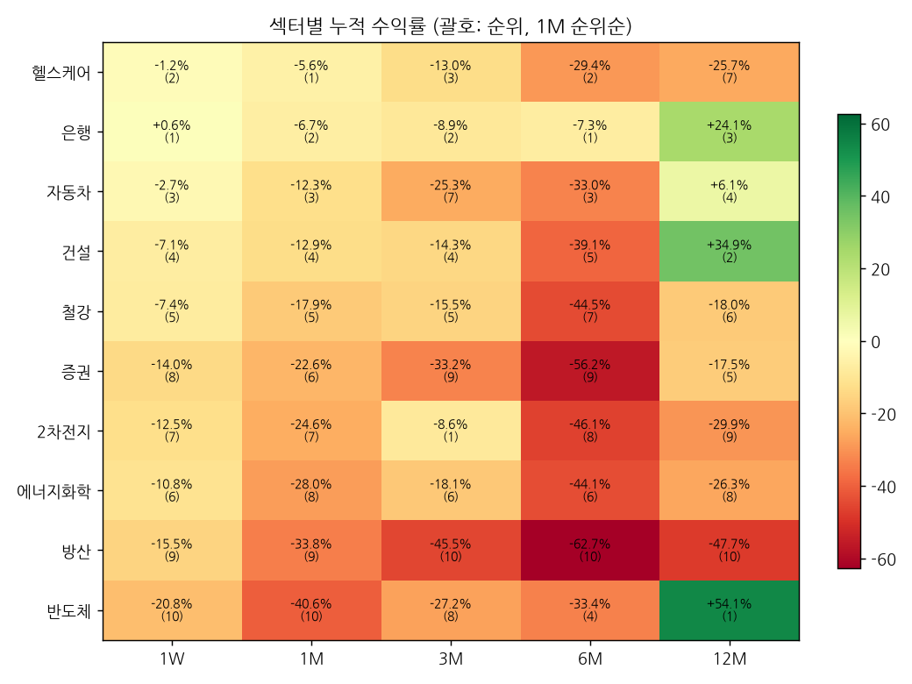

# 섹터 로테이션 & 관심종목 리포트 — 2026-11-09 (weekly)

## 1. 시그널
- 🔴 **[1M 순위 급변] 2차전지** — 2위 → 7위 (▼5)
- 🔴 **[주도 약화] 반도체** — 12M 1위·6M 4위 → 1M 10위·1W 10위
- 🔴 **[1W 순위 급변] 반도체** — 1위 → 10위 (▼9)
- 🔴 **[3M 순위 급변] 반도체** — 3위 → 8위 (▼5)
- 🔴 **[1W 순위 급변] 증권** — 3위 → 8위 (▼5)
- 🟢 **[1W 순위 급변] 건설** — 10위 → 4위 (▲6)
- 🟢 **[3M 순위 급변] 은행** — 7위 → 2위 (▲5)
- 🟢 **[1W 순위 급변] 자동차** — 9위 → 3위 (▲6)
- 🟢 **[1W 순위 급변] 헬스케어** — 8위 → 2위 (▲6)
- 🟢 **[3M 순위 급변] 헬스케어** — 6위 → 3위 (▲3)
- 🔵 **[주도 지속] 은행** — 전 기간 상위권

_순위변동 기준: 2026-11-02 리포트 대비_

## 2. 섹터 누적수익률 맵 (1M 순위순)
| 섹터 | 1W | 1M | 3M | 6M | 12M |
|---|---|---|---|---|---|
| **헬스케어** | -1.2% (2위 ▲6) | -5.6% (1위) | -13.0% (3위 ▲3) | -29.4% (2위 ▲2) | -25.7% (7위 ▲2) |
| **은행** | +0.6% (1위 ▲3) | -6.7% (2위 ▲2) | -8.9% (2위 ▲5) | -7.3% (1위) | +24.1% (3위) |
| **자동차** | -2.7% (3위 ▲6) | -12.3% (3위) | -25.3% (7위 ▲2) | -33.0% (3위) | +6.1% (4위) |
| **건설** | -7.1% (4위 ▲6) | -12.9% (4위 ▲2) | -14.3% (4위 ▼2) | -39.1% (5위 ▲2) | +34.9% (2위) |
| **철강** | -7.4% (5위 ▼3) | -17.9% (5위) | -15.5% (5위 ▼1) | -44.5% (7위 ▲1) | -18.0% (6위 ▲2) |
| **증권** | -14.0% (8위 ▼5) | -22.6% (6위 ▲1) | -33.2% (9위 ▼1) | -56.2% (9위) | -17.5% (5위) |
| **2차전지** | -12.5% (7위 ▼2) | -24.6% (7위 ▼5) | -8.6% (1위) | -46.1% (8위 ▼3) | -29.9% (9위 ▼3) |
| **에너지화학** | -10.8% (6위) | -28.0% (8위) | -18.1% (6위 ▼1) | -44.1% (6위) | -26.3% (8위 ▼1) |
| **방산** | -15.5% (9위 ▼2) | -33.8% (9위 ▲1) | -45.5% (10위) | -62.7% (10위) | -47.7% (10위) |
| **반도체** | -20.8% (10위 ▼9) | -40.6% (10위 ▼1) | -27.2% (8위 ▼5) | -33.4% (4위 ▼2) | +54.1% (1위) |

## 3. 관심종목 자동 업데이트
변동 없음

## 4. 기술적 지표 점검
### 삼성전자 (005930) — 현재가 191,000
- **이평선**: 역배열 · MA5 205,900▼ / MA20 218,550▼ / MA60 248,642▼ / MA120 270,283▼
- **크로스(최근)**: 없음
- **거래량**: 보합 · 5/20일 1.08x · 20/60일 1.0x · 당일/20일 0.4x
- **120일 매물벽**: 248,369 (+30.0%, 비중 6.4%) · 상단 총매물 99.5% → 매물대 하단(무거움) · 최대매물대 264,644 (+38.6%)
- **Cup&Handle**: 패턴 미성립 (점수 42) · 깊이 52.1% · 컵 95일 · 핸들 1일/되돌림 4.8% · 피벗 196,500 (+2.9%)
  - 미충족: 깊이 12~50%, 우측 회복 ≥85%, 핸들 5~25일, 핸들 컵 상단 절반

### SK하이닉스 (000660) — 현재가 1,152,000
- **이평선**: 역배열 · MA5 1,284,800▼ / MA20 1,332,300▼ / MA60 1,588,000▼ / MA120 1,834,825▼
- **크로스(최근)**: 데드 5/20 (2026-11-06), MA5 하향이탈, MA20 하향이탈
- **거래량**: 보합 · 5/20일 1.03x · 20/60일 1.09x · 당일/20일 0.37x
- **120일 매물벽**: 1,603,042 (+39.2%, 비중 6.3%) · 상단 총매물 99.2% → 매물대 하단(무거움) · 최대매물대 1,761,208 (+52.9%)
- **Cup&Handle**: 패턴 미성립 (점수 42) · 깊이 63.5% · 컵 91일 · 핸들 1일/되돌림 8.3% · 피벗 1,217,000 (+5.6%)
  - 미충족: 깊이 12~50%, 우측 회복 ≥85%, 핸들 5~25일, 핸들 컵 상단 절반

### 현대차 (005380) — 현재가 274,000
- **이평선**: 역배열 · MA5 282,900▼ / MA20 295,550▼ / MA60 353,167▼ / MA120 442,071▼
- **크로스(최근)**: MA5 하향이탈
- **거래량**: 보합 · 5/20일 1.02x · 20/60일 1.06x · 당일/20일 0.28x
- **120일 매물벽**: 299,719 (+9.4%, 비중 5.8%) · 상단 총매물 100.0% → 매물대 하단(무거움) · 최대매물대 407,115 (+48.6%)
- **Cup&Handle**: 패턴 미성립 (점수 42) · 깊이 65.8% · 컵 108일 · 핸들 1일/되돌림 4.9% · 피벗 286,000 (+4.4%)
  - 미충족: 깊이 12~50%, 우측 회복 ≥85%, 핸들 5~25일, 핸들 컵 상단 절반

---
_자동 생성. 투자 판단의 참고 자료이며 매매 권유가 아닙니다._