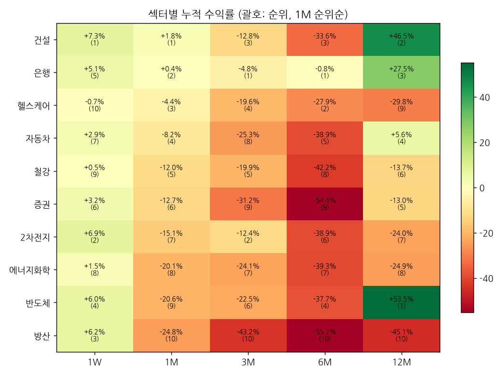

# 섹터 로테이션 & 관심종목 리포트 — 2026-11-16 (weekly)

## 1. 시그널
- 🔴 **[주도 약화] 반도체** — 12M 1위·6M 4위 → 1M 9위·1W 4위
- 🔴 **[1W 순위 급변] 은행** — 1위 → 5위 (▼4)
- 🔴 **[1W 순위 급변] 자동차** — 3위 → 7위 (▼4)
- 🔴 **[1W 순위 급변] 철강** — 5위 → 9위 (▼4)
- 🔴 **[주도 약화] 헬스케어** — 12M 9위·6M 2위 → 1M 3위·1W 10위
- 🔴 **[1W 순위 급변] 헬스케어** — 2위 → 10위 (▼8)
- 🟢 **[1W 순위 급변] 2차전지** — 7위 → 2위 (▲5)
- 🟢 **[1M 순위 급변] 건설** — 4위 → 1위 (▲3)
- 🟢 **[1W 순위 급변] 반도체** — 10위 → 4위 (▲6)
- 🟢 **[신규 주도 후보] 방산** — 12M 10위·6M 10위 → 1M 10위·1W 3위
- 🟢 **[1W 순위 급변] 방산** — 9위 → 3위 (▲6)
- 🔵 **[주도 지속] 건설** — 전 기간 상위권

_순위변동 기준: 2026-11-09 리포트 대비_

## 2. 섹터 누적수익률 맵 (1M 순위순)
| 섹터 | 1W | 1M | 3M | 6M | 12M |
|---|---|---|---|---|---|
| **건설** | +7.3% (1위 ▲3) | +1.8% (1위 ▲3) | -12.8% (3위 ▲1) | -33.6% (3위 ▲2) | +46.5% (2위) |
| **은행** | +5.1% (5위 ▼4) | +0.4% (2위) | -4.8% (1위 ▲1) | -0.8% (1위) | +27.5% (3위) |
| **헬스케어** | -0.7% (10위 ▼8) | -4.4% (3위 ▼2) | -19.6% (4위 ▼1) | -27.9% (2위) | -29.8% (9위 ▼2) |
| **자동차** | +2.9% (7위 ▼4) | -8.2% (4위 ▼1) | -25.3% (8위 ▼1) | -38.9% (5위 ▼2) | +5.6% (4위) |
| **철강** | +0.5% (9위 ▼4) | -12.0% (5위) | -19.9% (5위) | -42.2% (8위 ▼1) | -13.7% (6위) |
| **증권** | +3.2% (6위 ▲2) | -12.7% (6위) | -31.2% (9위) | -54.4% (9위) | -13.0% (5위) |
| **2차전지** | +6.9% (2위 ▲5) | -15.1% (7위) | -12.4% (2위 ▼1) | -38.9% (6위 ▲2) | -24.0% (7위 ▲2) |
| **에너지화학** | +1.5% (8위 ▼2) | -20.1% (8위) | -24.1% (7위 ▼1) | -39.3% (7위 ▼1) | -24.9% (8위) |
| **반도체** | +6.0% (4위 ▲6) | -20.6% (9위 ▲1) | -22.5% (6위 ▲2) | -37.7% (4위) | +53.5% (1위) |
| **방산** | +6.2% (3위 ▲6) | -24.8% (10위 ▼1) | -43.2% (10위) | -55.2% (10위) | -45.1% (10위) |

## 3. 관심종목 자동 업데이트
변동 없음

## 4. 기술적 지표 점검
### 삼성전자 (005930) — 현재가 198,700
- **이평선**: 역배열 · MA5 203,900▼ / MA20 213,500▼ / MA60 243,800▼ / MA120 267,088▼
- **크로스(최근)**: MA5 하향이탈
- **거래량**: 보합 · 5/20일 0.79x · 20/60일 0.95x · 당일/20일 0.3x
- **120일 매물벽**: 248,369 (+25.0%, 비중 6.6%) · 상단 총매물 98.2% → 매물대 하단(무거움) · 최대매물대 264,644 (+33.2%)
- **Cup&Handle**: 패턴 미성립 (점수 42) · 깊이 52.1% · 컵 95일 · 핸들 1일/되돌림 8.3% · 피벗 216,000 (+8.7%)
  - 미충족: 깊이 12~50%, 우측 회복 ≥85%, 핸들 5~25일, 핸들 컵 상단 절반

### SK하이닉스 (000660) — 현재가 1,154,000
- **이평선**: 역배열 · MA5 1,223,400▼ / MA20 1,301,900▼ / MA60 1,558,850▼ / MA120 1,809,500▼
- **크로스(최근)**: MA5 하향이탈
- **거래량**: 보합 · 5/20일 0.83x · 20/60일 1.04x · 당일/20일 0.32x
- **120일 매물벽**: 1,286,708 (+11.5%, 비중 5.7%) · 상단 총매물 98.8% → 매물대 하단(무거움) · 최대매물대 1,682,125 (+45.8%)
- **Cup&Handle**: 패턴 미성립 (점수 42) · 깊이 63.5% · 컵 91일 · 핸들 1일/되돌림 13.0% · 피벗 1,317,000 (+14.1%)
  - 미충족: 깊이 12~50%, 우측 회복 ≥85%, 핸들 5~25일, 핸들 컵 상단 절반

### 현대차 (005380) — 현재가 266,500
- **이평선**: 역배열 · MA5 270,500▼ / MA20 285,225▼ / MA60 340,292▼ / MA120 426,033▼
- **크로스(최근)**: 없음
- **거래량**: 보합 · 5/20일 0.77x · 20/60일 0.99x · 당일/20일 0.18x
- **120일 매물벽**: 296,438 (+11.2%, 비중 6.8%) · 상단 총매물 100.0% → 매물대 하단(무거움) · 최대매물대 404,562 (+51.8%)
- **Cup&Handle**: 패턴 미성립 (점수 42) · 깊이 66.3% · 컵 112일 · 핸들 1일/되돌림 4.8% · 피벗 279,000 (+4.7%)
  - 미충족: 깊이 12~50%, 우측 회복 ≥85%, 핸들 5~25일, 핸들 컵 상단 절반

---
_자동 생성. 투자 판단의 참고 자료이며 매매 권유가 아닙니다._